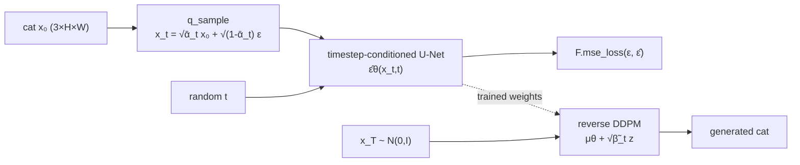

# CatDiffusion

CatDiffusion is a small, educational **unconditional pixel-space DDPM** trained
on cat images from the Oxford-IIIT Pet dataset. It implements the forward
process, noise-prediction objective, timestep-conditioned U-Net, and reverse
sampler directly in PyTorch. It is intentionally **not Stable Diffusion**:
there is no text conditioning, CLIP, classifier-free guidance, latent
autoencoder, or pretrained diffusion pipeline.

> **Status:** the repository contains code and reproducible tooling, not
> fabricated model weights or sample figures. Generated images and metrics in
> `outputs/` are produced only by running the programs.

## Install

Python 3.10+ is recommended. From the repository root:

```bash
python -m venv .venv
. .venv/bin/activate                 # Windows: .venv\Scripts\activate
python -m pip install -e .
```

The package uses PyTorch, torchvision, Pillow, NumPy, matplotlib, tqdm,
PyYAML, and pytest. Dependency versions are constrained in
[`requirements.txt`](./requirements.txt); the exact versions available on a
given CPU/CUDA system may differ.

## Quick CPU path

The smoke test uses synthetic images and never downloads data:

```bash
python scripts/train.py --config configs/cpu.yaml --device cpu --max-steps 1 --dry-run
pytest -q
```

To train on a small real subset, allow torchvision to download Oxford-IIIT
Pet:

```bash
python scripts/train.py --config configs/cpu.yaml --device cpu --max-steps 20
```

This is a correctness/demo preset, not a promise of recognizable cats.
Sampling still performs one reverse iteration per configured diffusion step;
reducing the number of steps reduces sampling work, not each training batch
proportionally.

## Training and generation

The CPU and Colab presets are readable YAML files. Important settings can be
overridden on the command line:

```bash
python scripts/train.py --config configs/colab.yaml --device auto \
  --epochs 50 --batch-size 32 --seed 42 --output-dir outputs

python scripts/generate.py --checkpoint checkpoints/model.pt --count 16 \
  --device auto --seed 42 --output-dir outputs
```

Generation reconstructs the model and diffusion schedule from checkpoint
metadata. A missing checkpoint is an error; random untrained weights are never
silently substituted. Checkpoints should be treated as trusted inputs because
loading model state is a local file operation.

Forward and reverse illustrations can be produced with:

```bash
python scripts/visualize_forward.py --config configs/cpu.yaml --device cpu
```

## Architecture



The U-Net has sinusoidal timestep embeddings, residual convolution blocks,
two downsampling stages, a bottleneck, and matching upsampling skip
connections. It has no attention modules in v1 and preserves RGB shape for
32×32 and 64×64 inputs.

## Equations mapped to code

| Concept | Equation | Implementation |
|---|---|---|
| Schedule | `α_t=1-β_t`, `ᾱ_t=∏ α_s` | `DiffusionSchedule` |
| Forward process | `x_t=√ᾱ_t x₀+√(1-ᾱ_t)ε` | `DDPM.q_sample` |
| Objective | `E[||ε-ε̂θ(x_t,t)||²]` | `training.train_step` with `F.mse_loss` |
| Reverse mean | `α_t⁻¹/²(x_t-β_t ε̂/√(1-ᾱ_t))` | `DDPM.p_sample` |
| Posterior variance | `β̃_t=β_t(1-ᾱ_{t-1})/(1-ᾱ_t)` | reverse sampler |

Python uses zero-based indices `i=0,...,T-1`; index `i` represents
mathematical timestep `t=i+1`. The cosine cumulative-alpha schedule is the
default because a short linear schedule can leave a terminal state that is
not close enough to Gaussian noise. The posterior variance is used for the
educational DDPM sampler, and the final reverse step adds no fresh noise.

Images are normalized from `[0,1]` to `[-1,1]` for the model. Intermediate
diffusion states are not silently clamped; only final displayed images are
clamped before conversion back to `[0,1]`.

## Dataset and attribution

The loader uses `torchvision.datasets.OxfordIIITPet` and explicitly selects
the 12 cat breed names from the official category metadata. `trainval` is the
training split; `test` is kept separate. Images are RGB, resized/center
cropped, optionally flipped, and normalized to `[-1,1]`.

Dataset source: [Oxford-IIIT Pet
Dataset](https://www.robots.ox.ac.uk/~vgg/data/pets/). Its applicable dataset
terms and attribution requirements remain separate from this code's MIT
license. The dataset is not committed to this repository.

## Colab

The tutorial notebook is [`notebooks/CatDiffusion_Tutorial.ipynb`](./notebooks/CatDiffusion_Tutorial.ipynb).
After publishing this repository, replace the clearly marked
`<GITHUB_USERNAME>/<REPOSITORY>` placeholder in the install cell and add this
badge:

[](https://colab.research.google.com/github/<GITHUB_USERNAME>/<REPOSITORY>/blob/main/notebooks/CatDiffusion_Tutorial.ipynb)

Colab free-tier availability, memory, and session duration vary. The notebook
offers a quick demo/full-training switch, saves to local storage, and only
mounts Google Drive after explicit user action.

## Reproducibility and limitations

Use `--seed` to seed Python, NumPy, and PyTorch. Checkpoint metadata records
the model, schedule, normalization, optimizer, epoch, and global step. Exact
bitwise reproducibility can still vary across PyTorch, CPU, CUDA, and
convolution implementations. CPU quick demos are intended to validate the
pipeline, not quality. OOM errors usually require a smaller image size,
`base_channels`, or batch size. A checkpoint must be trained or supplied by
the user; this repository does not claim to include pretrained weights.

The `assets/` directory is reserved for figures produced by real experiments.
No generated result is included here.

## References

* Ho, Jain, and Abbeel, “Denoising Diffusion Probabilistic Models,” 2020.
* Rombach et al., “High-Resolution Image Synthesis with Latent Diffusion
  Models,” 2022.
* Song et al., “Score-Based Generative Modeling through Stochastic
  Differential Equations,” 2021.

